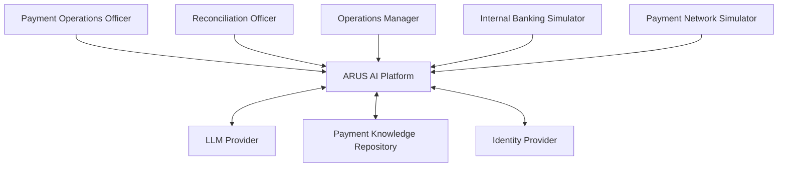
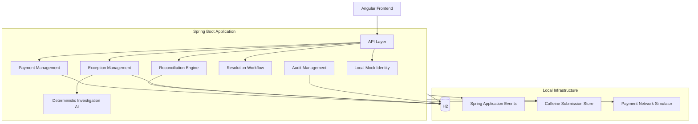
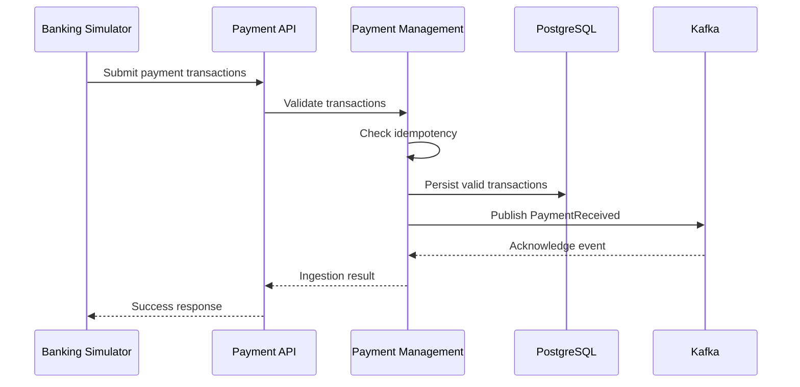
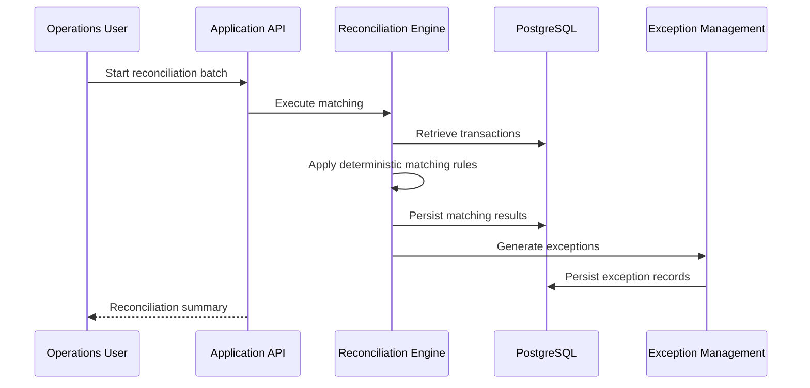
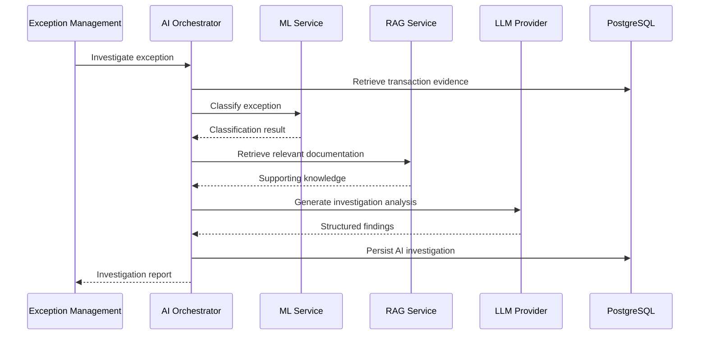
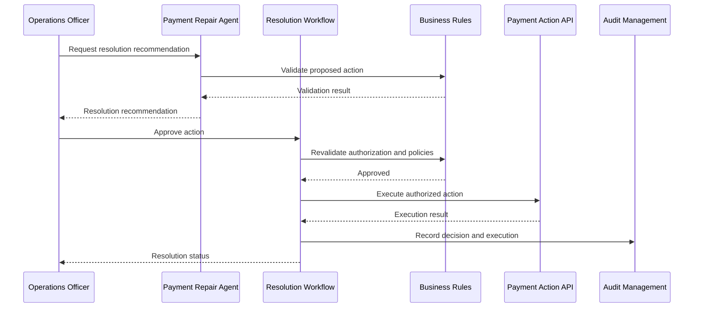
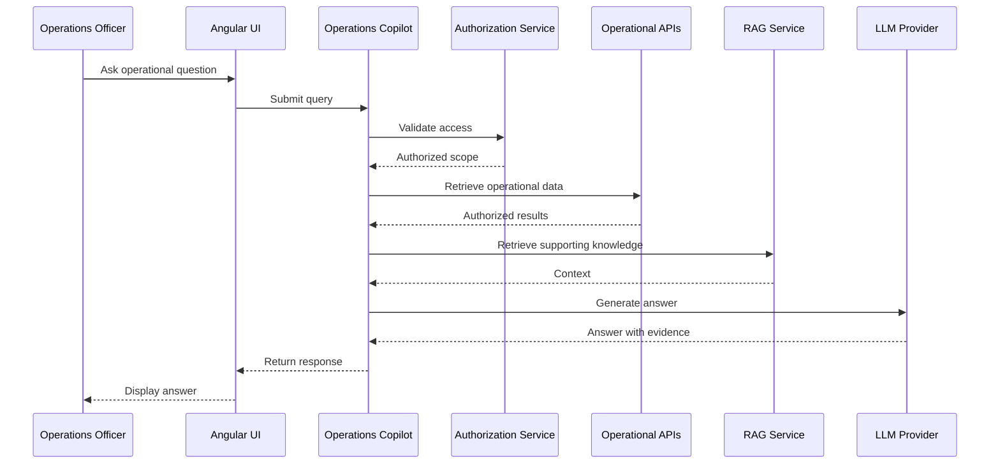
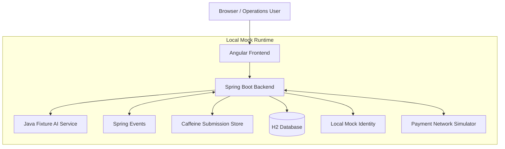

# ARUS AI — arc42 Architecture Documentation

**Product:** ARUS AI
**Positioning:** Intelligent Payment Operations Platform
**Tagline:** Intelligence Behind Every Transaction.
**Category:** Enterprise Banking AI / Payment Technology
**Architecture:** Modular, Event-Driven, AI-Enabled
**AI Approach:** Hybrid AI + Multi-Agent Architecture.

---

# 1. Introduction and Goals

## 1.1 Purpose

This document describes the software architecture of ARUS AI, an intelligent payment operations platform designed to automate payment reconciliation, detect transaction exceptions, investigate payment failures and recommend corrective actions using Artificial Intelligence.

The architecture combines:

- Deterministic payment processing.
- Machine Learning.
- Generative AI.
- Retrieval-Augmented Generation (RAG).
- Agentic AI.
- Human-in-the-loop governance.

The purpose is to demonstrate how AI can be safely integrated into enterprise banking systems without compromising financial integrity, operational controls or auditability.

## 1.2 Business Context

Financial institutions process high volumes of payment transactions across internal banking systems, external payment networks and settlement institutions.

Traditional payment operations rely heavily on predefined matching rules, manual investigation and operational intervention.

ARUS AI introduces intelligent automation to reduce manual workloads and improve payment operational visibility.

### Business objectives

1. Automate payment reconciliation.
2. Improve transaction exception detection.
3. Accelerate payment investigation.
4. Recommend evidence-based resolution actions.
5. Provide operational intelligence.
6. Introduce controlled agentic AI capabilities.
7. Maintain transparency, security and financial accountability.

## 1.3 Quality Goals

| Priority | Quality Goal | Description |
|---|---|---|
| 1 | Financial Integrity | Protect transaction consistency and prevent unauthorized financial changes |
| 2 | Reliability | Ensure payment and reconciliation processes remain reliable |
| 3 | Explainability | Provide evidence supporting AI-generated recommendations |
| 4 | Security | Protect sensitive financial information and operational actions |
| 5 | Scalability | Support increasing transaction volumes |
| 6 | Maintainability | Maintain modular and independently testable components |
| 7 | Performance | Process large reconciliation batches efficiently |
| 8 | Auditability | Maintain traceable operational and AI decisions |

## 1.4 Stakeholders

| Stakeholder | Interest |
|---|---|
| Payment Operations | Efficient exception investigation and resolution |
| Reconciliation Team | Accurate transaction matching |
| Operations Management | Operational performance and SLA monitoring |
| Compliance | Financial controls and auditability |
| IT Architecture | Integration, scalability and maintainability |
| AI Governance | Model performance and responsible AI |
| Security Team | Data protection and authorization |
| Business Management | Operational efficiency and cost reduction |

---

# 2. Architecture Constraints

The architecture must comply with the following technical and business constraints.

## 2.1 Business Constraints

**BC-001 — Financial Integrity**

AI must never directly modify financial ledger balances.

**BC-002 — Human Oversight**

Sensitive financial actions must require appropriate authorization.

**BC-003 — Auditability**

All significant payment operations, AI recommendations, approvals and executions must be traceable.

**BC-004 — Payment Standards**

The initial implementation must support ISO 20022-inspired payment data structures and simulated SEPA payment scenarios.

**BC-005 — Synthetic Data**

The initial implementation must use synthetic transaction data and simulated external payment network integrations.

## 2.2 Technical Constraints

| Constraint | Technology / Decision |
|---|---|
| Frontend | Angular |
| Core Backend | Java 25, Spring Boot |
| Java API Build Tool | Apache Maven |
| Investigation AI (implemented) | Java `InvestigationAiService` with deterministic fixtures |
| External AI providers | Deferred; implement behind `InvestigationAiService` |
| AI orchestration / ML | Deferred |
| Local Demo Database | File-backed H2 |
| Optional Database | PostgreSQL through the opt-in Maven `postgres` profile |
| Vector Search | Not implemented; pgvector deferred until retrieval is introduced |
| Messaging (implemented) | Spring application events behind `DomainEventPublisher` |
| Optional Messaging | Kafka adapter deferred |
| Cache (implemented) | Bounded Caffeine store behind `PaymentNetworkSubmissionStore` |
| Optional Cache | Redis adapter deferred |
| Authentication (implemented) | Local development-only mock identity |
| Optional Identity Provider | Keycloak/OIDC integration deferred |
| Containerization | Not required for local development |
| Orchestration | Not required for the initial implementation |
| Monitoring | Prometheus, Grafana |
| Tracing | OpenTelemetry |
| CI/CD | GitHub Actions |

Technology versions and compatibility must be validated before implementation.

## 2.3 Architectural Constraints

1. Core payment processing must remain independent of AI services.
2. AI workloads must be isolated from deterministic transaction processing.
3. All financial actions must pass through controlled backend services.
4. AI agents must access business capabilities through explicitly authorized tools.
5. Payment data must not be exposed to unauthorized AI services.
6. External LLM dependencies must not become mandatory dependencies for core reconciliation.
7. Financial records must be preserved with appropriate transaction and audit controls.

---

# 3. Context and Scope

## 3.1 Business Context

ARUS AI interacts with the following external actors and systems:

| External Actor / System | Interaction |
|---|---|
| Payment Operations Officer | Investigates and resolves exceptions |
| Reconciliation Officer | Reviews reconciliation results |
| Operations Manager | Monitors operational performance |
| Internal Banking System | Provides internal payment transactions |
| Payment Network Simulator | Provides external payment records and responses |
| LLM Provider | Provides generative AI capabilities |
| Knowledge Repository | Provides payment documentation and procedures |
| Identity Provider | Provides authentication and identity management |

## 3.2 System Context Diagram



## 3.3 System Responsibilities

ARUS AI is responsible for:

- Payment transaction ingestion.
- Payment reconciliation.
- Exception identification.
- Investigation management.
- AI-assisted root-cause analysis.
- Resolution recommendations.
- Approval workflows.
- Operational dashboards.
- AI governance and audit.

External banking systems and payment networks remain responsible for their own transaction processing and settlement operations.

---

# 4. Solution Strategy

## 4.1 Overall Architecture Strategy

ARUS AI adopts a hybrid architecture combining deterministic business processing with probabilistic AI capabilities.

The architecture is divided into five logical layers.

### Layer 1 — Application Layer

Provides user-facing functionality:

- Payment Operations Dashboard.
- Reconciliation Workbench.
- Exception Investigation Workbench.
- AI Operations Copilot.

### Layer 2 — Business Services Layer

Implements deterministic banking capabilities:

- Payment Management.
- Reconciliation Engine.
- Exception Management.
- Resolution Workflow.
- Audit Management.

### Layer 3 — AI Intelligence Layer

Target capabilities (not part of the current runtime):

- Machine Learning.
- LLM Integration.
- RAG.
- Multi-Agent Orchestration.
- AI Evaluation.

### Layer 4 — Integration Layer

Provides communication with external systems:

- REST APIs.
- Spring application events for local execution.
- Future Kafka event adapter.
- Payment Network Adapters.
- Local fixture-based investigation AI; future external AI provider adapters.
- Future knowledge-repository integration.

### Layer 5 — Infrastructure Layer

Current local infrastructure and deferred alternatives:

- H2; opt-in PostgreSQL profile.
- Caffeine submission-status store; Redis adapter deferred.
- Spring application events; Kafka adapter deferred.
- No vector store; pgvector deferred.
- Maven Spring Boot runtime.
- Monitoring and tracing are future capabilities.

## 4.2 Hybrid AI Strategy

### Local mock strategy

The default Spring profile must run the complete application with H2, Spring Events, mock authentication, the payment network simulator and deterministic mock AI responses.

Future FastAPI, external LLM, Kafka, Redis, pgvector and Keycloak integrations must be isolated
behind adapters so they do not change core payment or reconciliation behavior.

The local payment-network adapter returns deterministic simulated acceptance or rejection responses. Network submissions are dispatched through an after-commit Spring event listener and their status is kept in a bounded, expiring Caffeine cache. Local mock identity headers expose recognized ARUS roles for development only; they are not a production authentication mechanism.

Investigation reports are served by the Java `InvestigationAiService` interface, with a deterministic category-to-fixture implementation for the local demo. The report includes fixed confidence indicators and typed references to the persisted exception, reconciliation result, associated payment records, and investigation notes. Fixture confidence is illustrative rather than calibrated. The service is read-only and advisory: it does not execute recommendations, call an external LLM, or depend on Python. A future adapter can implement the same interface when those integrations are approved.

The following are target AI capabilities, not implemented services. The current investigation
service returns deterministic fixtures and does not run machine learning, retrieval or an LLM.

| Business Problem | Target Approach |
|---|---|
| Exact transaction matching | Deterministic rules |
| Ambiguous transaction matching | ML-assisted candidate ranking |
| Duplicate detection | Deterministic rules + ML |
| Transaction anomalies | Unsupervised ML |
| Exception classification | Supervised ML |
| Payment failure prediction | Supervised ML |
| Investigation explanation | LLM + RAG |
| Root-cause investigation | Agentic AI |
| Resolution recommendations | Agentic AI + business rules |
| Operations assistance | RAG + conversational AI |

### Core principle

**Deterministic systems make financial decisions. AI provides intelligence and recommendations. Authorized humans control sensitive actions.**

## 4.3 Multi-Agent Strategy

Multi-agent orchestration is a future direction; LangGraph and the agents below are not implemented.

Potential future agents:

1. Reconciliation Agent.
2. Payment Investigation Agent.
3. Payment Repair Agent.
4. Operations Intelligence Agent.
5. Operations Copilot.

Agents must not communicate with banking infrastructure using unrestricted database access.

All agent capabilities must be exposed through controlled application APIs or explicitly authorized tools.

## 4.4 Integration Strategy

- Synchronous operations use REST APIs.
- Local domain events use Spring application events through `DomainEventPublisher`.
- A Kafka adapter is deferred.
- Current investigation reports use deterministic Java fixtures; AI workflows/orchestration are deferred.
- External payment integrations use adapter interfaces.
- AI providers use an abstraction layer to support provider replacement.
- Java REST APIs are built, tested and packaged with Apache Maven.

## 4.5 Architectural Style

The current release is a **Modular Monolith**. Investigation fixtures run in-process; no independently
deployable Python AI service or external infrastructure component is required.

This is preferable to introducing numerous microservices prematurely.

The design preserves module boundaries so that components can be extracted into independent services
when justified by scaling, ownership or operational requirements.

---

# 5. Building Block View

## 5.1 Level 1 — System Decomposition

The current local system consists of the following building blocks. PostgreSQL is optional and
requires an existing server; the other listed integrations are local implementations.



## 5.2 Level 2 — Core Application Modules

### 5.2.0 Angular Operations UI

The standalone Angular application in `frontend/` consumes the Spring Boot REST API through a
development-server proxy to `http://localhost:8080`. It provides dashboard, transaction,
reconciliation and exception workbenches. The interface uses the existing API for payment records,
reconciliation results, exception investigation, fixture-based AI reports, audit history and
approvals. Controls are shown according to the selected local roles; the API remains authoritative
for authorization.

The local sign-in screen selects a demo username and one or more roles, validates the selection with
`GET /api/v1/session`, and attaches `X-Mock-User` and `X-Mock-Roles` to API calls. The identity is
retained in browser local storage for local development convenience. This is a mock identity
mechanism only, not production authentication. Start the API with Maven, then start the Angular
development server from `frontend/`; no Docker, database server or external service is required.

Infrastructure boundaries are kept replaceable: persistence uses Spring Data repositories,
domain-event publication uses `DomainEventPublisher`, submission status uses
`PaymentNetworkSubmissionStore`, network calls use `PaymentNetworkAdapter`, and investigation
reports use `InvestigationAiService`. The local implementations are selected in the `local` and
`test` profiles. PostgreSQL is available through the opt-in `postgres` Maven/Spring profile.
Kafka, Redis, Keycloak, pgvector and external AI provider adapters remain deferred; see
`docs/INTEGRATIONS.md` for the contracts and activation policy.

### 5.2.1 Payment Management Module

Responsibilities:

- Import internal payment transactions.
- Import external payment records.
- Maintain transaction lifecycle.
- Validate payment data.
- Prevent duplicate ingestion.
- Publish payment events.

The local batch-import endpoint accepts JSON records or CSV with the exact fields `source,transactionReference,endToEndId,amount,currency,counterparty,valueDate,status`. Requests require a persisted idempotency key (maximum 120 characters); matching retries replay their saved response, while changed payloads under the same key conflict. Each batch is capped at 10,000 records and CSV content at 5 MiB. Duplicate references are returned as per-row outcomes and excluded from persistence. A post-commit Spring event is published only when new records have been stored.

Key domain objects:

- PaymentTransaction.
- ExternalTransaction.
- PaymentNetwork.
- PaymentEvent.
- PaymentStatus.

### 5.2.2 Reconciliation Engine

Responsibilities:

- Execute matching rules.
- Perform exact transaction matching.
- Perform composite matching.
- Identify unmatched transactions.
- Detect duplicate records.
- Calculate reconciliation discrepancies.
- Generate reconciliation results.

Matching strategy:

1. Exact transaction reference matching.
2. End-to-end identifier matching.
3. Amount and currency matching.
4. Date and counterparty matching.
5. ML-assisted candidate ranking for ambiguous cases.

Financially significant matches must be confirmed by deterministic validation and applicable review policies.

The initial Java API implementation uses deterministic one-to-one matching in priority order: exact transaction reference, unique end-to-end identifier, then a unique exact amount/currency/value-date/counterparty key. Identifier matches with a different amount, currency, date, counterparty, or a failed/rejected payment status are persisted as discrepancies; unmatched records remain explicit results. Batch execution and matching evidence are persisted. Ambiguous candidates are not auto-paired, and ML ranking, one-to-many matching, tolerances, and exception generation remain later capabilities.

### 5.2.3 Exception Management Module

Responsibilities:

- Generate exception cases.
- Classify discrepancies.
- Assign severity.
- Manage investigation lifecycle.
- Assign cases to users.
- Track SLA.
- Record investigation outcomes.
- Preserve investigation notes and append-only audit history.
- Route sensitive resolution and closure actions through independent approval.

The Java API creates an exception for each unmatched or discrepant reconciliation result. Assignment is limited to reconciliation officers, operations managers, and payment administrators. Severity changes require an operations manager, compliance officer, or payment administrator. Operators and reconciliation officers can add investigation notes and request resolution; an operations manager or compliance officer must approve or reject. Self-approval is prohibited. A close request is permitted only after resolution and follows the same independent approval rule. The request, decision, actor, and justification are persisted; assignment, severity, notes, and lifecycle changes are audited.

Repeated reconciliation runs do not generate duplicate open exceptions for payment records with an existing exception.

### 5.2.4 Resolution Workflow Module

Responsibilities:

- Receive AI resolution recommendations.
- Validate proposed actions.
- Enforce authorization policies.
- Manage approval workflows.
- Execute authorized operational actions.
- Record execution outcomes.

This module is the only authorized application entry point for sensitive resolution actions.

### 5.2.5 Audit Management Module

Responsibilities:

- Record user actions.
- Record AI execution metadata.
- Record AI recommendations.
- Record approval decisions.
- Record resolution execution.
- Maintain audit correlation identifiers.

Audit records must be protected against unauthorized modification.

## 5.3 Level 2 — AI Platform Modules

This is a future design sketch, not a description of deployed services. The current application
provides an in-process `InvestigationAiService` implementation backed by deterministic fixtures.

### 5.3.1 AI Orchestrator

Potential technology: Python + LangGraph.

Responsibilities:

- Coordinate agent workflows.
- Manage workflow state.
- Execute conditional routing.
- Handle retries and timeouts.
- Manage human approval checkpoints.
- Maintain execution traces.

### 5.3.2 Machine Learning Service

Technology: Python + scikit-learn + XGBoost.

Responsibilities:

- Anomaly detection.
- Duplicate detection.
- Exception classification.
- Payment failure prediction.
- Transaction candidate ranking.

### 5.3.3 RAG Service

Responsibilities:

- Document ingestion.
- Text chunking.
- Embedding generation.
- Vector retrieval.
- Context preparation.
- Source attribution.

Knowledge sources:

- ISO 20022 documentation.
- Payment network specifications.
- Error code catalogues.
- Payment operational procedures.
- Internal operational knowledge.

### 5.3.4 Agent Services

The initial Payment Investigation Agent capability is exposed by `GET /api/v1/exceptions/{exceptionId}/investigation-report`. Its mock implementation returns category-specific fixture summaries and recommendations with confidence indicators, and references only evidence retrieved from the application's persisted records. It does not infer unavailable facts, mutate workflow state, or execute recommendations.

| Agent | Main Responsibility |
|---|---|
| Reconciliation Agent | Investigate unmatched transactions |
| Payment Investigation Agent | Identify probable root causes |
| Payment Repair Agent | Recommend corrective actions |
| Operations Intelligence Agent | Identify operational patterns |
| Operations Copilot | Provide natural-language interaction |

## 5.4 Module Dependency Rules

1. Frontend must communicate with backend through APIs.
2. AI services must not directly access core banking database tables.
3. Core business services must not depend on LLM availability.
4. Agents must invoke authorized business tools through application interfaces.
5. Resolution execution must remain under the control of the Resolution Workflow Module.
6. Audit recording must cover all governed financial actions.
7. Infrastructure dependencies must be hidden behind appropriate application interfaces.

---

# 6. Runtime View

This section describes important runtime scenarios and component interactions.

## 6.1 Scenario 1 — Payment Transaction Ingestion



Key architectural requirements:

- Idempotent ingestion.
- Data validation.
- Duplicate prevention.
- Transactional persistence.
- Reliable event publication.

The implementation should use the transactional outbox pattern to avoid inconsistencies between database commits and Kafka publication.

## 6.2 Scenario 2 — Payment Reconciliation



The reconciliation engine must be deterministic and repeatable.

## 6.3 Scenario 3 — AI Payment Investigation



The investigation report must contain:

- Exception classification.
- Probable root cause.
- Supporting evidence.
- Evidence references.
- Confidence and uncertainty information.
- Recommended next steps.

LLM-generated hypotheses must be clearly distinguished from verified transaction facts.

## 6.4 Scenario 4 — AI-Assisted Payment Resolution



Important controls:

- AI cannot approve its own recommendations.
- Approval must be bound to a specific action and its parameters.
- Authorization must be revalidated at execution time.
- Actions must be idempotent where applicable.
- All execution outcomes must be audited.

## 6.5 Scenario 5 — Operations Copilot



The Copilot must not bypass the normal authorization model.

---

# 7. Deployment View

## 7.1 Deployment Strategy

The initial deployment runs locally without containers or external infrastructure.

The Spring Boot and Angular applications can be started with Maven and a local Node/npm workflow. H2, Spring Events, in-memory caching, mock authentication, simulated payment networks and mock AI responses provide a complete demonstration runtime.

PostgreSQL has an opt-in Maven/Spring profile and requires a separately provisioned server. Kafka,
Redis, Keycloak, pgvector and external AI providers are deferred integrations, not available
connectors. None are required for the local demo. See `docs/INTEGRATIONS.md` for implemented
boundaries and activation status.

## 7.2 Logical Deployment Architecture



## 7.3 Infrastructure Components

| Component | Deployment |
|---|---|
| Angular Frontend | Local development server |
| Spring Boot Backend | Maven runtime |
| Investigation AI | In-process deterministic Java fixture service |
| Payment Network | In-process simulator |
| Authentication | Local development-only mock identity |
| Messaging | Spring Events |
| Database | H2 by default; optional PostgreSQL profile with an external server |
| Cache | Bounded Caffeine implementation |
| Vector Search | Not currently used |
| Monitoring | Not currently configured |

## 7.4 Environment Strategy

The platform should support:

- Local development.
- Integration testing.
- Staging / demonstration.
- Optional production-like deployment.

Sensitive credentials must be supplied through environment-specific secrets management rather than committed to source control.

## 7.5 Scalability Strategy

Current architecture:

- Modular Spring Boot application.
- File-backed H2 persistence by default; PostgreSQL through the opt-in profile.
- In-process Spring application events.
- Bounded Caffeine submission-status store.
- In-process deterministic investigation AI.

Future scaling and integration options:

- Kafka adapter for event delivery.
- Redis-backed submission-status store.
- Independent AI workers, if external AI capabilities are implemented.

- Extract reconciliation into a dedicated service.
- Scale AI agents independently.
- Introduce dedicated ML model serving.
- Introduce separate event storage and analytical databases.
- Adopt managed Kafka and database infrastructure.

---

# 8. Cross-Cutting Concepts

## 8.1 Security Architecture

Security is implemented across application, infrastructure and AI layers.

### Authentication

The current local demo selects a username and one or more roles in the Angular sign-in screen. The
UI validates this mock identity with `GET /api/v1/session` and sends `X-Mock-User` and
`X-Mock-Roles` headers; the local Spring Security filter maps those headers to authorities. This is
development-only and does not authenticate a real user. Production deployments must replace it with
a trusted identity provider and must not accept client-supplied role headers.

### Authorization

Implement role-based access control.

Initial roles:

- PAYMENT_OPERATOR.
- RECONCILIATION_OFFICER.
- OPERATIONS_MANAGER.
- PAYMENT_ADMIN.
- COMPLIANCE_OFFICER.
- AI_GOVERNANCE_OFFICER.
- SYSTEM_ADMIN.

### Data Protection

- Encrypt data in transit.
- Encrypt data at rest.
- Mask sensitive information.
- Restrict AI provider access.
- Maintain secure secrets management.
- Apply data retention policies.

### AI Security

- Treat transaction records and retrieved documents as untrusted input.
- Protect against prompt injection.
- Restrict agent tools.
- Validate all tool parameters.
- Apply user authorization to data retrieval.
- Prevent unrestricted SQL execution.
- Maintain AI execution traces.

## 8.2 Data Architecture

The architecture separates operational data, knowledge data and AI execution data.

### Operational Data

The local profile stores operational records in file-backed H2 and applies schema changes through Flyway. PostgreSQL may be configured for external deployments.

Operational storage includes:

- `payment_record` stores internal and external transactions using a source discriminator.
- `payment_network` stores network configuration.
- `reconciliation_batch` and `reconciliation_result` store batch execution and matching evidence.
- `payment_exception` and `investigation` store discrepancy and investigation lifecycle state.
- `approval` stores human authorization decisions.
- `audit_log` stores actor, action, aggregate and event details.

Payment records are exposed through create, list and get operations under `/api/v1/payments`. API DTO validation and database constraints enforce required fields, unique source/reference pairs and decimal monetary precision.

### Knowledge Data

No knowledge retrieval or vector data store is implemented in the current application. PostgreSQL
and pgvector support for knowledge retrieval remains a future integration.

### AI Execution Data

Stores:

- Agent execution IDs.
- Workflow states.
- Model versions.
- Recommendations.
- Confidence information.
- Evaluation metadata.

## 8.3 Event-Driven Architecture

The current local runtime publishes domain events through `DomainEventPublisher`, backed by Spring
application events and after-commit listeners. Kafka is not currently connected; a future adapter
must preserve post-commit publication and idempotent consumer behavior.

Initial domain events:

| Event | Producer | Consumer |
|---|---|---|
| PaymentReceived | Payment Management | Reconciliation |
| ReconciliationStarted | Reconciliation | Monitoring |
| ReconciliationCompleted | Reconciliation | Exception Management |
| ExceptionDetected | Exception Management | AI Orchestrator |
| InvestigationRequested | Exception Management | AI Orchestrator |
| InvestigationCompleted | AI Orchestrator | Exception Management |
| ResolutionProposed | AI Orchestrator | Resolution Workflow |
| ResolutionApproved | Resolution Workflow | Action Processor |
| ResolutionExecuted | Action Processor | Audit / Monitoring |

Event schemas should be versioned and include correlation identifiers.

## 8.4 AI Architecture

The current AI implementation is an in-process deterministic fixture service. The following model,
orchestration, RAG and ML strategies are future options and are not active in the runtime.

### Future Model Strategy

Use a provider abstraction to avoid tight coupling to one LLM vendor.

Initial options:

- OpenAI models.
- Google Gemini models.

### Future Agent Orchestration

LangGraph manages:

- Agent state.
- Conditional routing.
- Tool execution.
- Human approval checkpoints.
- Workflow retries.
- Execution tracing.

### Future RAG Strategy

RAG is used to retrieve relevant information from trusted knowledge sources.

The system must provide evidence references and avoid presenting unsupported generated statements as facts.

### Future ML Strategy

Initial models:

- Isolation Forest for anomaly detection.
- XGBoost for exception classification.
- XGBoost for failure prediction.
- Candidate ranking for ambiguous transaction matching.

Models must be evaluated using labelled test datasets and appropriate baselines.

## 8.5 Observability

Use:

- Prometheus for metrics.
- Grafana for dashboards.
- OpenTelemetry for distributed tracing.
- Structured application logging.

Monitor:

- API latency.
- Reconciliation throughput.
- Kafka consumer lag.
- Exception volume.
- AI execution latency.
- LLM token consumption.
- AI agent failure rate.
- Recommendation acceptance rate.
- Model drift.
- Unauthorized action attempts.

## 8.6 Error Handling and Resilience

- Retry transient network failures.
- Apply circuit breakers to external dependencies.
- Use dead-letter queues.
- Implement idempotency.
- Apply timeouts to AI calls.
- Persist workflow state.
- Support resumable agent workflows.
- Provide manual fallback when AI is unavailable.

Core reconciliation must continue operating when the LLM provider is unavailable.

## 8.7 AI Evaluation and Governance

AI evaluation must be an architectural capability, not an afterthought.

Measure:

- Classification precision and recall.
- Anomaly detection quality.
- Root-cause analysis accuracy.
- Evidence grounding.
- Recommendation acceptance rate.
- Hallucination rate.
- Agent task completion rate.
- Latency and token consumption.
- Unauthorized action prevention.

Maintain versioned evaluation datasets and regression tests.

## 8.8 Testing Strategy

Testing layers:

1. Unit testing.
2. Integration testing.
3. API testing.
4. Contract testing.
5. Event-driven testing.
6. AI evaluation testing.
7. Security testing.
8. Performance testing.
9. End-to-end testing.

Financial integrity and authorization tests must be mandatory release gates.

---

# 9. Architecture Decisions

The table distinguishes decisions implemented in the current local application from deferred target
architecture decisions. Deferred items do not imply that a corresponding connector or service exists.

| ADR | Decision | Status | Rationale |
|---|---|---|---|
| ADR-001 | Modular Monolith for core application | Implemented | Reduce initial complexity and preserve clear module boundaries |
| ADR-002 | Python for AI services | Deferred | Mature AI and ML ecosystem |
| ADR-003 | Spring Boot for core banking services | Implemented | Strong enterprise application and integration capabilities |
| ADR-004 | LangGraph for agent orchestration | Deferred | Explicit stateful workflows and human approval checkpoints |
| ADR-005 | Hybrid AI architecture | Direction | Combine deterministic correctness with AI intelligence |
| ADR-006 | Kafka for asynchronous messaging | Deferred | Decoupling and scalable event processing |
| ADR-007 | H2 by default; PostgreSQL as an optional database | Implemented | Local-first development with a path to relational deployments |
| ADR-008 | pgvector for initial vector search | Deferred | Simplify infrastructure and knowledge retrieval |
| ADR-009 | Human approval for sensitive actions | Implemented | Preserve financial accountability |
| ADR-010 | Provider abstraction for LLMs | Deferred | Reduce vendor dependency |
| ADR-011 | Synthetic payment data | Implemented | Enable safe and reproducible demonstrations |
| ADR-012 | ISO 20022-inspired data model | Implemented | Demonstrate European payment domain knowledge |
| ADR-013 | Maven for Spring Boot API builds | Implemented | Standardize Java dependency management, builds and test execution |

### ADR-001 — Modular Monolith vs Microservices

**Decision:** Adopt a modular monolith for core banking business capabilities.

**Context:** Introducing multiple independently deployed services from the beginning would increase operational complexity without sufficient demonstrated need.

**Consequences:**

Positive:
- Simpler development.
- Easier debugging.
- Lower deployment overhead.
- Strong transactional boundaries.

Negative:
- Requires strict module dependency management.
- Independent scaling of core modules is limited.

Future extraction should be based on measurable operational requirements.

### ADR-002 — Separation of AI and Core Banking Services

**Decision:** Deploy Python AI services separately from the Spring Boot core application.

**Context:** AI workloads have different resource requirements, deployment cycles and failure characteristics.

**Consequences:**

Positive:
- Independent scaling.
- Technology flexibility.
- Fault isolation.
- Easier AI model experimentation.

Negative:
- Additional network communication.
- More complex distributed tracing.
- Additional operational infrastructure.

### ADR-003 — Deterministic vs Probabilistic Processing

**Decision:** Financially significant transaction processing must remain deterministic.

**Context:** LLM outputs are probabilistic and cannot guarantee financial calculation accuracy or repeatable execution.

**Consequences:**

- Financial calculations use deterministic application code.
- Reconciliation rules are versioned.
- AI recommendations require validation.
- Human approvals govern sensitive actions.

### ADR-013 — Maven for Spring Boot API Development

**Decision:** Build and package the Java core application and REST APIs with Apache Maven.

**Context:** The Java backend requires consistent dependency resolution, repeatable builds, test execution and Spring Boot packaging.

**Consequences:**

- The repository uses a Maven `pom.xml` and Maven-compatible dependency declarations.
- Spring Boot applications are packaged with Maven plugins.
- CI/CD executes Maven build and test goals.
- Maven project conventions remain compatible with IDE and container build tooling.

---

# 10. Quality Requirements

## 10.1 Quality Scenarios

### QS-001 — High-Volume Reconciliation

**Scenario:** The system receives a batch containing 100,000 payment transactions.

**Expected response:**
- The system processes the batch without data loss.
- Matching results are persisted consistently.
- Exceptions are generated correctly.
- Processing throughput is measurable.

### QS-002 — LLM Provider Unavailability

**Scenario:** The external LLM provider becomes unavailable.

**Expected response:**
- Core reconciliation continues.
- Existing payment data remains accessible.
- AI investigation requests enter a retryable state.
- Users can perform manual investigation.

### QS-003 — Unauthorized Resolution Attempt

**Scenario:** An AI agent attempts to execute a financial action without valid approval.

**Expected response:**
- The backend rejects the action.
- No financial operation is performed.
- The attempt is recorded.
- Appropriate alerts are generated.

### QS-004 — High AI Latency

**Scenario:** An investigation requires longer processing time.

**Expected response:**
- The request is processed asynchronously.
- Workflow state is persisted.
- The user can monitor progress.
- Results are delivered when available.

### QS-005 — Duplicate Payment Event

**Scenario:** Kafka delivers the same payment event more than once.

**Expected response:**
- Idempotency prevents duplicate financial records.
- Event processing remains consistent.
- Duplicate event information is traceable.

## 10.2 Performance Targets

Initial demonstration targets:

| Metric | Target |
|---|---:|
| Reconciliation batch size | 100,000 transactions |
| Ordinary API response time | P95 below 500 ms |
| Reconciliation accuracy | At least 99% on defined test datasets |
| Duplicate detection precision | At least 99% on defined test datasets |
| AI investigation coverage | At least 85% of eligible exceptions |
| Investigation time reduction | At least 70% versus measured baseline |
| Governed action audit coverage | 100% |

These targets must be validated through performance and evaluation tests. They are not production service-level commitments.

---

# 11. Risks and Technical Debt

## 11.1 Architecture Risks

| Risk | Impact | Mitigation |
|---|---|---|
| LLM hallucination | Incorrect investigation conclusions | Evidence grounding and validation |
| AI prompt injection | Unauthorized information or actions | Input isolation and restricted tools |
| Incorrect ML predictions | Misclassified exceptions | Evaluation datasets and human review |
| External LLM dependency | AI service disruption | Provider abstraction and fallback |
| Kafka event duplication | Duplicate processing | Idempotent consumers |
| Data inconsistencies | Incorrect reconciliation | Transactional persistence and validation |
| Agent workflow failure | Incomplete investigations | Persisted state and retry mechanisms |
| Excessive LLM costs | Increased operating costs | Token budgets, caching and model selection |
| Data leakage | Exposure of sensitive banking data | Data masking, authorization and secure provider integration |
| Over-engineered architecture | Increased delivery complexity | Modular monolith and incremental delivery |

## 11.2 Initial Technical Debt

The following items may be deferred during the showcase implementation:

- Production payment network connectivity.
- Advanced distributed model serving.
- Dedicated vector database infrastructure.
- Multi-region deployment.
- Advanced active-active disaster recovery.
- Full enterprise secrets management integration.
- Production-grade regulatory compliance certification.

These limitations must be documented and must not be misrepresented as production-ready capabilities.

---

# 12. Glossary

| Term | Definition |
|---|---|
| ARUS AI | Intelligent Payment Operations Platform |
| Payment Reconciliation | Process of comparing internal and external payment records |
| Payment Exception | A transaction discrepancy requiring investigation |
| Settlement | Final transfer or discharge of payment obligations |
| ISO 20022 | International financial messaging standard |
| SEPA | Single Euro Payments Area |
| AI Agent | AI component capable of reasoning and invoking authorized tools |
| Agentic AI | AI system that executes multi-step tasks using controlled workflows |
| RAG | Retrieval-Augmented Generation |
| LLM | Large Language Model |
| ML | Machine Learning |
| Human-in-the-Loop | Human involvement in decisions and approvals |
| Deterministic Processing | Processing that produces predictable results for identical inputs and conditions |
| Probabilistic Processing | Processing involving statistical uncertainty |
| Idempotency | Property ensuring repeated requests do not create unintended duplicate effects |
| Outbox Pattern | Pattern for reliably publishing events associated with database transactions |
| RBAC | Role-Based Access Control |
| ADR | Architecture Decision Record |
| P95 | 95th percentile response time |

---

# Appendix A — Recommended Repository Structure

```text
arus-ai/
│
├── README.md
├── REQUIREMENTS.md
├── arc42.md
├── LICENSE
├── pom.xml
├── mvnw
├── mvnw.cmd
│
├── docs/
│   ├── architecture/
│   │   ├── diagrams/
│   │   │   ├── system-context.mmd
│   │   │   ├── container.mmd
│   │   │   ├── component.mmd
│   │   │   ├── deployment.mmd
│   │   │   └── sequence/
│   │   ├── adr/
│   │   │   ├── ADR-001-modular-monolith.md
│   │   │   ├── ADR-002-ai-service-separation.md
│   │   │   └── ADR-003-hybrid-ai.md
│   │   └── architecture-decisions.md
│   │
│   ├── api/
│   ├── domain/
│   ├── ai/
│   ├── security/
│   └── deployment/
│
├── frontend/
│   └── arus-web/
│
├── backend/
│   └── arus-core/
│       └── pom.xml
│
├── ai/
│   └── arus-intelligence/
│
├── infrastructure/
│   ├── kafka/
│   ├── database/
│   └── monitoring/
│
├── datasets/
│   ├── payments/
│   ├── reconciliation/
│   └── exceptions/
│
├── scripts/
│
└── tests/
    ├── integration/
    ├── performance/
    ├── security/
    └── ai-evaluation/
```

---

# Appendix B — Architecture Documentation Governance

This document should evolve alongside the implementation.

Update the architecture documentation whenever:

- A major architectural decision changes.
- A new integration is introduced.
- A new AI agent is added.
- A business module is extracted.
- A security or governance mechanism changes.
- A significant quality attribute is modified.

Architecture decisions must be recorded in ADRs rather than silently changing the architecture.

**Document owner:** ARUS AI Architecture Team
**Review frequency:** At major development milestones
**Next review:** Before Phase 1 implementation

---

**End of Document**

*ARUS AI — Intelligence Behind Every Transaction.*